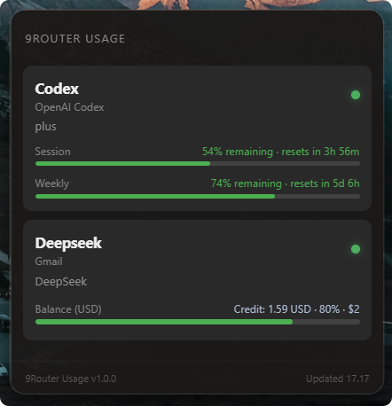

# 9Router Usage

[](LICENSE)
[](https://tauri.app)
[](#requirements)
[](https://apps.microsoft.com/detail/9NR91D484XF6)

A lightweight Windows and Linux system-tray application for monitoring provider quotas and credit balances from a local or remote [9Router](https://github.com/decolua/9router) instance.

<p align="center">
  
</p>

## Features

- Connect to any 9Router instance, including the default local API endpoint at `http://localhost:20128/v1`.
- Monitor all provider connections exposed by the 9Router dashboard API.
- Display remaining quota, reset countdowns, account names, plans, and provider status.
- Display monetary credit balances such as DeepSeek in USD.
- Configure a local reference budget for credit providers and show it as a progress bar.
- Automatically refresh in the background, with configurable intervals and manual refresh.
- Native desktop notifications when quota or credit becomes low.
- Secure optional password storage using Windows Credential Manager or Linux Secret Service.
- English and Indonesian interface languages.
- Filter inactive providers and sort by dashboard order, active status, lowest quota, or name.
- Dynamic popup height with a minimum size and scrolling only when required.
- System tray integration, auto-hide on focus loss, optional pinning, and autostart support.
- Dark Windows 11-style interface powered by Tauri 2.

## Requirements

- Windows 10/11 x64 with Microsoft Edge WebView2 Runtime, or Linux x64 with WebKitGTK 4.1 and GTK 3 (Ubuntu 22.04+ recommended).
- A running [9Router](https://github.com/decolua/9router) instance (local or remote).
- On Linux: a desktop with AppIndicator support and a notification service. GNOME generally needs the **AppIndicator and KStatusNotifierItem Support** extension.
- To remember passwords on Linux: an unlocked Secret Service-compatible keyring, such as GNOME Keyring or KWallet with Secret Service enabled.

The default server URL is:

```text
http://localhost:20128/v1
```

This matches the API Endpoint shown in the 9Router dashboard, so it can be copied and pasted directly. URLs without the `/v1` suffix remain supported. Remote HTTP, HTTPS, IP address, hostname, and custom-port installations can be configured from the connection screen or Settings.

## Installation

Install from the [Microsoft Store](https://apps.microsoft.com/detail/9NR91D484XF6) after the listing becomes publicly available, or download the latest Windows installer from this repository's **Releases** page.

Typical release artifacts:

```text
9Router-Usage_1.0.1_x64-setup.exe
9Router-Usage_1.0.1_x64_en-US.msi
9Router-Usage-1.0.1-portable-x64.zip
9Router-Usage-1.0.1-store-x64.msix
checksums.txt
```

Use the `.exe` or `.msi` package for a normal installation. Alternatively, extract the portable `.zip` and run `9Router Usage.exe` directly without installation. Portable mode still stores settings in `%APPDATA%\9RouterUsage` and, when enabled, passwords in Windows Credential Manager.

After launching the application, open it from the Windows system tray and enter your 9Router dashboard password. When **Remember password securely** is enabled, the password is stored in Windows Credential Manager and used for automatic login.

### Linux installation

Download the `.deb`, `.rpm`, or `.AppImage` package from **Releases** (available after the next tagged release).

```bash
# Ubuntu / Debian: apt also installs package dependencies
sudo apt install ./<downloaded-package>.deb

# Fedora
sudo dnf install ./<downloaded-package>.rpm

# AppImage
chmod +x ./<downloaded-package>.AppImage
./<downloaded-package>.AppImage
```

AppImages may need FUSE 2 (`libfuse2` on Ubuntu 22.04; `libfuse2t64` on Ubuntu 24.04). Alternatively, use `--appimage-extract-and-run`.

Linux settings are stored in `$XDG_CONFIG_HOME/9RouterUsage/settings.json`, defaulting to `~/.config/9RouterUsage/settings.json`. Existing settings from `~/9RouterUsage` or `~/9RouterMonitor` are migrated automatically. Passwords are stored in the desktop Secret Service, never in the settings file. If no unlocked keyring is available, disable **Remember password securely** to sign in without persistence.

On Linux, click the tray icon and select **Show** to open the popup, or **Quit** to exit. GNOME requires the AppIndicator extension mentioned above. The Linux popup is positioned at the top-right of the current monitor when positioning is supported. GTK prefers XWayland when available to support positioning; native Wayland still controls placement. An explicit `GDK_BACKEND` preference is respected. Linux Settings offers System / Light / Dark themes with no outer popup border. Windows styling and tray behavior remain unchanged. The app also opens when launched again, useful if the tray is unavailable; autostart launches it hidden.

## Usage

1. Start your 9Router server.
2. Launch 9Router Usage.
3. Click its system tray icon (on Linux, select **Show** from the menu).
4. Enter the 9Router server URL and dashboard password.
5. Use the refresh button to force a quota update, or let the application refresh automatically.
6. Open Settings to configure language, refresh interval, provider sorting, notifications, inactive-provider filtering, secure password storage, and autostart.

Closing the popup hides it to the tray. Use the tray's **Show / Quit** menu to open the popup or exit the application.

## Local Development

### Prerequisites

- [Node.js 20+](https://nodejs.org)
- [Rust](https://rustup.rs) with the `x86_64-pc-windows-msvc` toolchain
- Visual Studio Build Tools with **Desktop development with C++**
- Microsoft Edge WebView2 Runtime

### Linux prerequisites

Install Node.js 20+ and the native Linux Rust toolchain via [rustup](https://rustup.rs). On Ubuntu 22.04/24.04:

```bash
sudo apt update
sudo apt install -y build-essential curl wget file libwebkit2gtk-4.1-dev \
  libxdo-dev libssl-dev librsvg2-dev libayatana-appindicator3-dev libdbus-1-dev patchelf
npm ci
npm run tauri dev
```

Run in a graphical desktop session with D-Bus available. Linux builds use GTK/WebKitGTK; this is expected, unlike native Windows builds.

```bash
npm run build
cargo check --locked --manifest-path src-tauri/Cargo.toml
npm run tauri build -- --bundles deb,rpm,appimage
```

Linux packages are generated under `src-tauri/target/release/bundle/`.

### Run in development mode (Windows)

```powershell
npm install
npm run tauri dev
```

Run the project from native Windows PowerShell rather than WSL. A native Windows build should launch an executable ending in `.exe` and should not show GTK or Mesa messages.

### Validate the project

```powershell
npm run build
cargo check --manifest-path src-tauri/Cargo.toml
```

### Build installers

```powershell
npm run tauri build
```

Generated installers are placed under:

```text
src-tauri\target\release\bundle
```

## Release Workflow

The workflow in `.github/workflows/release.yml` builds Windows installers, a portable archive, an unsigned Microsoft Store MSIX, and Linux x64 `.deb`, `.rpm`, and `.AppImage` packages when a version tag is pushed. Windows hashes are published in `checksums.txt`, Linux hashes in `checksums-linux.txt`:

```powershell
git tag v1.0.1
git push origin v1.0.1
```

The Store MSIX uses the reserved identity `afridho.9RouterUsage` and is intentionally unsigned for direct Partner Center submission. See [STORE_SUBMISSION.md](STORE_SUBMISSION.md) for build and certification instructions.

## Architecture

- **Tauri 2 / Rust** — system tray, native window behavior, secure credential access, notifications, polling, and 9Router API communication
- **React 19 / TypeScript** — popup interface and settings
- **Vite** — frontend development and production builds
- **Windows Credential Manager / Linux Secret Service** — optional secure password persistence

## 9Router API Usage

The application communicates with the configured 9Router dashboard through endpoints such as:

```text
POST /api/auth/login
GET  /api/auth/status
POST /api/auth/logout
GET  /api/providers
GET  /api/usage/{connectionId}
GET  /api/usage/stats?period=7d
```

Quota responses from different providers are normalized by the Rust backend before being sent to the UI.

## Privacy and Security

- The dashboard password is sent only to the configured 9Router server.
- When password remembering is enabled, credentials are stored in Windows Credential Manager or Linux Secret Service, separated by server hostname.
- Passwords are not written to `settings.json` or bundled into the frontend.
- Disconnecting removes the saved credential for the active server.
- The application does not include analytics, advertising, or tracking SDKs.

See the complete [Privacy Policy](PRIVACY.md).

## License

Licensed under the [MIT License](LICENSE).
